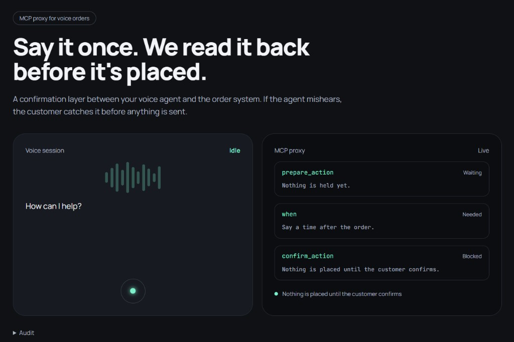

# VoiceGate

A household confirm layer for voice orders. It reads the order back, asks for a time, and waits for yes. The cafe is not called until then. Pizza is three dollars. Money is fake.



Source lives in [`WINNER/voicegate`](WINNER/voicegate).

```bash
cd WINNER/voicegate
npm install
npm run cafe
npm run proxy
```

Open `http://127.0.0.1:3002/` in Chrome or Edge.
